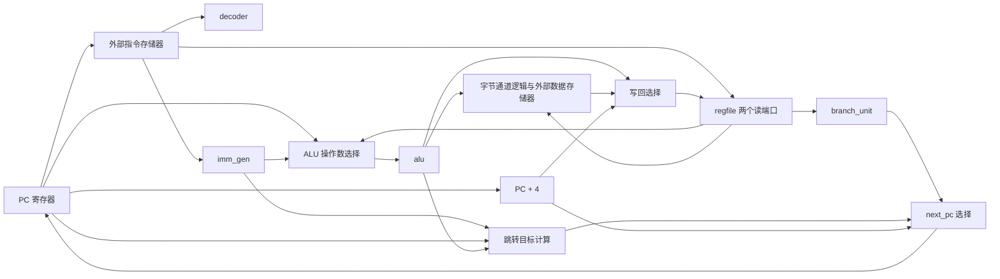

# RV32I 单周期 CPU 教学基线

本实现使用 Verilog-2001。每条正常指令在一个周期内完成取指、译码、执行、访存和写回；PC、寄存器堆和 trap 状态在时钟上升沿更新。reset 为高电平同步复位，复位时 PC = 0、所有通用寄存器 = 0、trap = 0。x0 的读端恒为零，写端拒绝写入 x0。

CPU 不包含具体 FPGA RAM、M/C 扩展、CSR、特权级、中断、Cache 或流水线。没有创建 PDS 工程，也没有修改现有 counter 工程。RTL 中没有仿真延迟、initial、系统任务或不可综合的测试逻辑。

## 文件结构

```text
fpga-riscv/
├── README_CPU.md
├── rtl/cpu/
│   ├── cpu_top.v
│   ├── cpu_defs.vh
│   ├── pc.v
│   ├── decoder.v
│   ├── imm_gen.v
│   ├── regfile.v
│   ├── alu.v
│   └── branch_unit.v
├── tb/cpu/
│   ├── tb_pc.v
│   ├── tb_imm_gen.v
│   └── tb_cpu.v
├── scripts/
│   └── test_cpu.ps1
└── build/                       # 自动生成，不作为 RTL 输入
    ├── cpu/
    │   ├── tb_pc.vvp / tb_imm_gen.vvp / tb_cpu.vvp
    │   └── 对应的 .compile.log 和 .log
    └── wave/
        ├── tb_pc.vcd
        ├── tb_imm_gen.vcd
        └── tb_cpu.vcd
```

`rtl/counter.v`、`tb/tb_counter.v` 和 `counter_pds/` 保持原样。原有 `pc.v` 增加了 `next_pc` 输入，原有 `tb_pc.v` 已同步更新；PC 的顺序递增由顶层数据通路决定。

## 数据通路



图中的 decoder 控制操作数、立即数格式、ALU 操作、访存宽度、写回和跳转选择。trap 逻辑检查当前指令和地址，并统一禁止故障指令的提交；图中省略这些控制连线以保持可读性。

1. **取指和译码**：`imem_addr` 始终等于当前 PC。decoder 是唯一的 opcode 译码入口，产生控制信号；imm_gen 只按 decoder 给出的格式拼接立即数。
2. **读取和执行**：寄存器堆组合读取 rs1/rs2。ALU 的 A 输入从 rs1、PC、0 中选择，B 输入从 rs2、imm 中选择。LUI 使用 `0 + imm`，AUIPC 使用 `PC + imm`，load/store 和 JALR 使用 `rs1 + imm`。
3. **访存和写回**：load 从返回的对齐字中选取字节/半字并扩展；store 移位写数据并生成字节写使能。rd 从 ALU、load 数据、PC+4 三者中选择。
4. **下一条指令**：默认 PC+4；taken branch 和 JAL 使用 `PC + imm`；JALR 使用 `(rs1 + imm) & 32'hfffffffe`。JAL/JALR 写回旧 PC+4，因此 `rd == rs1` 的 JALR 也能正确工作。
5. **时钟沿提交**：正常指令更新 PC，并按需写寄存器和数据存储器；故障指令保持 PC、不写寄存器、不写内存，并置位 trap。

所有组合 always 块使用阻塞赋值，并提供默认赋值或完整的 case/default。所有 RTL 时序 always 块使用非阻塞赋值。寄存器堆采用两个组合读端和一个同步写端；全寄存器复位有助教学观察，通常会实现为寄存器资源，不能据此假定会映射成块 RAM。

## 模块职责

| 文件 | 职责 |
|---|---|
| `cpu_top.v` | 连接数据通路，选择 ALU 操作数/写回源/next_pc，处理 load/store 字节通道、对齐检查和 trap 提交控制 |
| `pc.v` | 保存 PC；同步复位为 0，否则装入 next_pc |
| `decoder.v` | 集中进行 opcode/funct 合法性检查并产生控制信号；OP/OP-IMM 共用 ALU 译码，load/store 共用宽度与地址控制 |
| `imm_gen.v` | 产生 I/S/B/U/J 立即数，不再次译码 opcode |
| `regfile.v` | 32×32 位寄存器堆、双组合读/单同步写、x0 保护 |
| `alu.v` | 加减、逻辑、比较和移位；移位量只取低 5 位 |
| `branch_unit.v` | 六种条件分支比较，不做目标地址加法或 opcode 译码 |
| `cpu_defs.vh` | 共享内部控制编码与 trap cause 常量，不引入额外硬件模块 |

R/I/S/B/U/J 是六种**指令格式**，其中 R 型没有立即数；立即数实际有 I/S/B/U/J 五种格式。SLTIU 的立即数仍先符号扩展，再进行无符号比较。算术右移显式使用 `$signed`；LB/LH 符号扩展，LBU/LHU 零扩展。

## 存储接口契约

| 信号 | 方向 | 语义 |
|---|---|---|
| `imem_addr[31:0]` | 输出 | 当前指令的字节地址 |
| `imem_rdata[31:0]` | 输入 | 对应指令，组合读取 |
| `dmem_addr[31:0]` | 输出 | 完整的有效字节地址，保留最低两位 |
| `dmem_rdata[31:0]` | 输入 | 地址 `dmem_addr & ~3` 开始的整个 32 位字，组合读取 |
| `dmem_wdata[31:0]` | 输出 | 已移位到对应 byte lane 的写数据 |
| `dmem_we` | 输出 | 当前周期允许在上升沿执行 store |
| `dmem_wstrb[3:0]` | 输出 | 每位对应一个写入字节，bit 0 对应对齐字的最低地址字节 |

采用**小端序**、无等待周期、无 ready/valid 握手。每周期从 PC 经取指、计算、读数据到写回的组合路径必须在下一个上升沿前稳定。外部数据存储器仅在上升沿且 `dmem_we == 1` 时按 wstrb 更新对应字节。

例：SB 到地址 0x41 时，`dmem_addr = 0x41`、`dmem_wstrb = 0010`，rs2 的低字节放在 `dmem_wdata[15:8]`。SH 到 0x42 时使用 strobe `1100`，rs2 的低半字放在高两个 byte lane。非 store、reset 或 trap 期间，we 和 wstrb 均为零；其他周期的地址/写数据无需解读。

此接口没有读使能，适用于无读取副作用的普通存储器；不能直接用持续的 `dmem_addr` 访问带读副作用的 MMIO。没有总线访问错误反馈，也不检查物理存储器容量。

**同步读的 FPGA 块 RAM 不能直接满足当前组合读契约。** 后续接 FPGA 时需要使用符合契约的存储实现，或明确修改 CPU 时序/握手。这里保持 CPU 与 Pango RAM 原语解耦，不推断已经完成 PDS 综合、布局布线或时序收敛。

## 指令支持

| 类别 | 指令 |
|---|---|
| 高位立即数 | LUI、AUIPC |
| 无条件跳转 | JAL、JALR |
| 条件分支 | BEQ、BNE、BLT、BGE、BLTU、BGEU |
| load | LB、LH、LW、LBU、LHU |
| store | SB、SH、SW |
| 立即数运算 | ADDI、SLTI、SLTIU、XORI、ORI、ANDI、SLLI、SRLI、SRAI |
| 寄存器运算 | ADD、SUB、SLL、SLT、SLTU、XOR、SRL、SRA、OR、AND |
| 栅栏 | FENCE：当前有序单核存储模型中作为 NOP；忽略保留操作数字段 |
| 环境调用 | ECALL、EBREAK：输出并锁存 trap |

共 40 条 RV32I 指令。FENCE.I 属于未实现的 Zifencei 扩展，会触发非法指令；M、C、CSR 编码和其他不支持的 opcode/funct 组合也会触发非法指令。非移位 OP-IMM 的 instr[31:25] 是立即数数据，不会被错误限制为 funct7。

## Trap 约定

`trap` 和 `trap_cause[3:0]` 在检测到故障的上升沿锁存；故障指令不产生寄存器或 store 写入，PC 保持在该指令地址。即使外部改变指令数据，CPU 仍保持停止，直至 reset。没有 trap vector、CSR、异常返回或特权级切换。

| trap_cause | 含义 |
|---:|---|
| 0 | 指令地址未按 4 字节对齐，包括实际 taken 的分支/跳转目标 |
| 2 | 非法或未实现的指令 |
| 3 | EBREAK |
| 4 | load 地址未按访问宽度对齐 |
| 6 | store 地址未按访问宽度对齐 |
| 11 | ECALL；仅借用该数值作为调试约定，不表示实现了机器特权模式 |

LB/LBU/SB 无对齐限制；LH/LHU/SH 必须 2 字节对齐；LW/SW 必须 4 字节对齐。本实现不拆分非对齐访问，采用停止执行的 trap 策略。非对齐检查适用于写入 x0 的 load。未 taken 的分支不因其目标非对齐而 trap。JALR 仅清 bit0，若目标 bit1 仍为 1，照常触发指令地址对齐 trap。

以上指令格式、跳转与 FENCE 语义参照 [RISC-V 官方 RV32I 规范](https://docs.riscv.org/reference/isa/v20240411/unpriv/rv32.html)。停止直到复位、调试 cause 和复位通用寄存器是本教学实现的接口选择。

## 编译和仿真

在工程根目录运行：

```powershell
powershell -NoProfile -ExecutionPolicy Bypass -File scripts/test_cpu.ps1
```

脚本可从其他工作目录调用，会自行切换到工程根目录。每组测试均使用 `-g2001 -Wall`，创建输出目录，检查编译/仿真退出码、PASS/FAIL 标记并保存日志；任何编译诊断、FAIL 或缺少 PASS 都会导致脚本失败。仅使用 Verilog-2001 的 `$display/$finish`，无需 SystemVerilog `$fatal`。

CPU 测试的手工等价命令（PowerShell，工程根目录）：

```powershell
New-Item -ItemType Directory -Path build/cpu,build/wave -Force | Out-Null
$rtl = Get-ChildItem rtl/cpu/*.v | ForEach-Object { $_.FullName }
iverilog -g2001 -Wall -I rtl/cpu -s tb_cpu -o build/cpu/tb_cpu.vvp $rtl tb/cpu/tb_cpu.v
vvp build/cpu/tb_cpu.vvp
```

使用 PDS 导入 RTL 时应包含上述七个 `.v` 文件，设置顶层 `cpu_top`，并把 `rtl/cpu` 加入 Verilog include 搜索路径；不要把 `tb/` 或 build 产物作为综合输入。本次未运行 PDS。

本次 Icarus 实测结果：

```text
PASS tb_pc: reset, sequential, redirect, hold
PASS tb_imm_gen: 12357 checks (exhaustive I/S/B, J/U boundaries)
PASS tb_cpu: 1351 checked instruction cycles + 22 program clocks; 23 trap cases
PASS all CPU tests (-g2001 -Wall, no compiler diagnostics)
```

测试包含：

- I/S 所有 4096 个立即数、B 所有 4096 个偶数偏移；J/U 的逐位与正负边界检查，并使用固定机器码交叉验证拼接。
- 所有支持的指令；48 组确定性操作数组合分别执行 10 种寄存器运算和 9 种立即数运算，包括极值、溢出回绕和大于 31 的寄存器移位量。
- 每个定向测试周期检查 PC、trap、32 个通用寄存器、256 字节内存；store 还检查地址、数据和 wstrb，其他周期检查没有 store 写使能。
- 所有 byte lane、两种半字位置、符号/零扩展、负地址偏移、部分写不破坏邻接字节、x0 写入保护。
- 六种分支 taken/not-taken、相等边界、负 B/J 偏移、JAL/JALR link、JALR rd=rs1 与 bit0 清零。
- 无测试逐条注入的连续程序：循环计算 1+2+3+4+5，调用子程序再加 1，返回后 store，最后 ECALL；检查最终 PC、全部寄存器和内存。
- 23 类 trap 场景及锁存保持、故障无副作用、reset 后恢复。

这些是自检仿真测试，不替代完整 ISA 一致性认证或 FPGA 综合/时序验证。

## 最值得人工审查的五处

1. **`decoder.v` 的 OP/OP-IMM 分支**：共享 ALU 译码中的 ADD/SUB、SRL/SRA 选择，以及 funct7 合法性；确认普通立即数高位不被误判，M/非法移位不会作为 RV32I 运算执行。
2. **`imm_gen.v` 的 B/J 拼接**：检查符号位、instr[7]/instr[20] 等离散位和末尾补零；这里最容易发生偏移翻倍或负偏移错误。
3. **`cpu_top.v` 的 load/store 字节通道**：核对小端序、对齐字读取约定、lane_shift、符号扩展及 SB/SH/SW 的掩码与写数据是否一致。
4. **`cpu_top.v` 的 redirect/target 与 fault/提交控制**：检查 PC+4 link、JALR 仅清 bit0、只检查 taken 分支目标，以及 fault/trap/reset 是否同时阻止 PC 前进和所有写入。
5. **`alu.v` 与 `branch_unit.v` 的有符号运算**：检查 SLT/SLTU、BLT/BLTU、BGE/BGEU 的操作数类型，SRA 的 `$signed` 和所有移位的低 5 位限制；结合 SLTIU 的符号扩展立即数一起审查。

后续做流水线时，可从这里识别取指、译码/寄存器读、执行、访存、写回的组合边界，再添加流水寄存器及相关控制。本版本到单周期基线为止。
